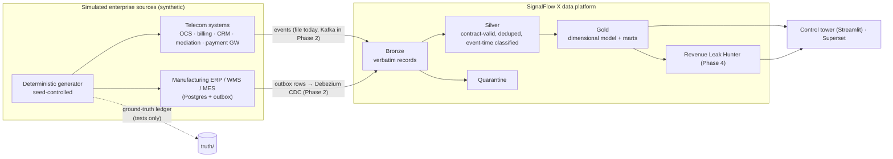
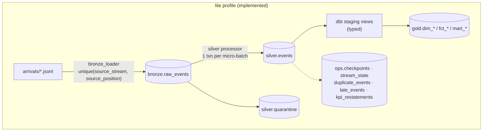
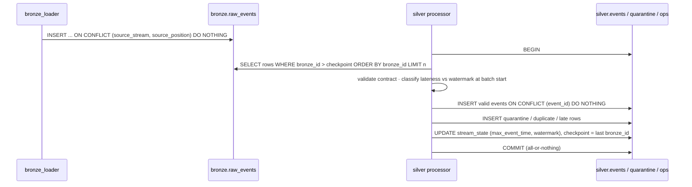
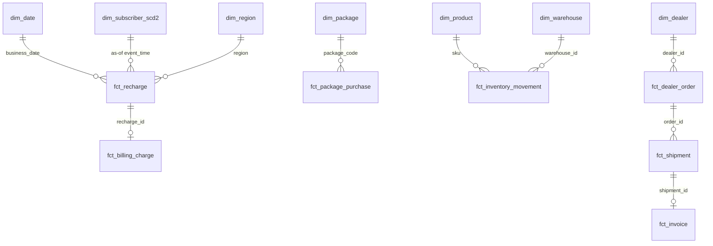
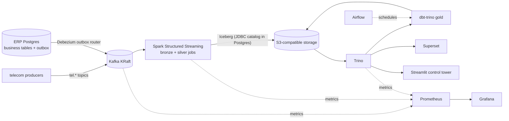

# SignalFlow X — Architecture

Status: Phase 0 design, Phase 1 implemented for the `lite` profile. Sections marked *(planned)* are designs, not
working code yet.

## 1. Context

## 2. Two deployment profiles, one design

The same contracts, layer semantics and tests apply to both profiles. The lite profile is not a toy: it is the
reference implementation used to check the distributed one (differential testing, Phase 3).

| Concern | `lite` (Phase 1, runs today) | `full` (Phases 2–5, planned) |
|---------|------------------------------|------------------------------|
| Transport | JSONL arrival files, ingested in arrival order | Kafka 4.x (KRaft); Debezium outbox CDC for ERP |
| Bronze | `bronze.raw_events` in Postgres | Iceberg table on S3-compatible storage |
| Silver | Python micro-batch processor, transactional checkpoint | PySpark Structured Streaming, checkpoint + idempotent MERGE |
| Gold | dbt on Postgres | dbt on Trino over Iceberg |
| Orchestration | `signalflow` CLI / Makefile | Airflow |
| BI | Streamlit (Phase 6) | Superset + Streamlit |
| Observability | `ops.*` tables + structured logs | + Prometheus/Grafana |

## 3. Layer contracts

### Bronze — raw and auditable
* One row per received record, including duplicates and unparseable lines. Original line text is stored verbatim
  (`raw_record`) with its SHA-256.
* Identity: `(source_stream, source_position)`; for files `arrivals:<file>:<line>`, for Kafka
  `<topic>:<partition>:<offset>`. Re-delivery of the same position is a no-op (idempotent load).
* Columns extracted best-effort for indexing (`event_id`, `event_type`, `event_time`), never trusted downstream.
* Replay: Silver can be rebuilt from Bronze by resetting the checkpoint (Phase 5 Time Machine builds on this).
* Sensitive data: the generator produces no personal data (no names, no phone numbers), so Bronze needs no masking.
  In a real deployment Bronze would be the most restricted layer.

### Silver — trusted events
* `silver.events`: one row per unique `event_id`, payload as `jsonb`, plus `stream`, `event_time`,
  `arrival_class`, `lateness_seconds`, `contract_id`, `bronze_id` (lineage back to the exact raw record).
* Typed per-entity views (`silver.stg_*`) are built by dbt with explicit casts.
* Validation, quarantine, dedupe and lateness rules: see [DATA_CONTRACTS.md](DATA_CONTRACTS.md).

### Gold — business-ready
See §5 for the model. Gold is fully rebuilt by dbt in the lite profile (cheap at this size, and it makes late-data
restatement correct by construction). Incremental models are a Phase 3 optimisation with a measured baseline.

## 4. Processing semantics

Guarantee stated precisely: within one Postgres database, each Bronze row affects Silver exactly once, because
writes and checkpoint commit atomically. Crash → rollback → the next run re-reads the same rows. This is tested
with fault injection. It is not end-to-end exactly-once across systems, and no such claim is made.

## 5. Gold dimensional model (Phase 1 scope)

| Model | Grain | Primary key | Notes |
|-------|-------|-------------|-------|
| `dim_date` | calendar day (Asia/Dhaka) | `date_day` | Fri/Sat weekend |
| `dim_subscriber_scd2` | subscriber × validity interval | `subscriber_sk` | SCD2 on segment, home_region, status; justified because revenue must be attributed to the segment/region *at the time* |
| `dim_region`, `dim_package`, `dim_product`, `dim_warehouse`, `dim_dealer` | one row per member | natural key | from reference data |
| `fct_recharge` | one recharge attempt | `recharge_id` | business date, channel, status, amount, as-of subscriber key |
| `fct_billing_charge` | one balance credit | `charge_id` | |
| `fct_package_purchase` | one activation | `activation_id` | with capture status |
| `fct_usage` | one rated usage record | `usage_id` | |
| `fct_channel_settlement` | channel × business date | `settlement_id` | |
| `fct_inventory_movement` | one movement | `movement_id` | |
| `fct_dealer_order` | one order line | `order_id` | current status derived from status/shipment events |
| `fct_shipment` | one shipment | `shipment_id` | dispatch and delivery timestamps |
| `fct_invoice` | one invoice | `invoice_id` | settled amount, settlement status |
| `mart_telecom_revenue_daily` | business date × region × channel | composite | KPI finality column |
| `mart_telecom_subscribers_daily` | business date × region × segment | composite | active base from SCD2 |
| `mart_inventory_position` | warehouse × SKU | composite | on hand, 7-day outbound, days of cover (derived) |
| `mart_mfg_sales_daily` | business date × dealer region × category | composite | |

## 6. Full-profile design *(planned)*

Key decisions are recorded as ADRs in [`docs/adr/`](adr).

## 7. Risk assessment

| # | Risk | Likelihood | Impact | Mitigation |
|---|------|-----------|--------|-----------|
| R1 | Full profile exceeds WSL2 memory on a 16 GB laptop | High | High | profiles; per-service memory limits; Airflow/Superset only in `full`; measured RAM in reports |
| R2 | MinIO community images are no longer published the way they used to be; the image could not be pulled in the build environment | Medium | Medium | treat storage as "S3-compatible"; pin a known MinIO release where pullable, SeaweedFS as tested fallback (ADR-0005, verified in Phase 3) |
| R3 | Debezium 3.x images are on quay.io, which this build environment cannot reach | Medium | Medium | Debezium 2.7.3 on Docker Hub works with Kafka 4 brokers; pin whichever the Phase 2 spike proves |
| R4 | Spark ↔ Iceberg ↔ Kafka connector version drift | Medium | High | one compatibility spike in Phase 2 before any streaming code; versions pinned in ADR-0005 |
| R5 | Two Silver implementations (Python lite, Spark full) drift apart | Medium | High | shared JSON Schema contracts; differential test on the same seed must produce identical event-id sets and totals |
| R6 | Synthetic data too regular to be credible | Medium | Medium | Dhaka hourly demand curve, regional weights, segment behaviour, Fri/Sat effects, supply disruptions |
| R7 | Ground truth leaks into detection logic | Low | High | truth written outside pipeline paths; source-scan test; detection rules reviewed against ledger fields |
| R8 | Docker Hub rate limits during setup | Medium | Low | compose file uses `mirror.gcr.io` defaults overridable via env |
| R9 | Overclaiming (exactly-once, "production ready") | Medium | High (credibility) | every guarantee in docs links to the test that demonstrates it |
