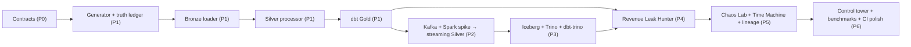

# SignalFlow X — Implementation Plan

Rule: a phase is complete only when its acceptance tests pass in CI and its report (results, limitations, demo
steps) is in `docs/reports/`. The next phase starts after that, one phase at a time.

## MVP (smallest thing worth showing a hiring panel)

Phases 1–2 plus the Revenue Leak Hunter's telecom rules: deterministic data → contract-validated, deduped,
event-time-aware Silver → reconciled Gold → leak cases with evidence, with crash-recovery proven by tests. Everything
else builds on that.

## Critical path

## Phases

| Phase | Scope | Acceptance criteria (measurable) | Depends on |
|-------|-------|----------------------------------|------------|
| **0** Research & architecture | requirements, contracts, architecture, ADRs, plan, test strategy | contract unit tests pass; every contract has a valid sample; minor versions proven compatible | — |
| **1** Functional foundation (lite) | generator, Postgres schemas, bronze loader, silver processor, dbt Gold, CLI, compose `lite`, CI | E2E on seed 7: bronze rows = lines; silver ids = truth ids; quarantine = injected breaks; gold revenue = truth revenue to the poisha; inventory on-hand = truth; re-ingest adds 0 rows; crash+resume = clean run; same seed ⇒ identical files | 0 |
| **2** Streaming | compose `stream`; version spike; Kafka topics per contract; telecom producer; ERP outbox + Debezium; Spark bronze/silver jobs with checkpoints, dedupe, watermark, quarantine topic | integration tests in containers: duplicate storm ⇒ unique counts unchanged; Spark killed mid-stream and restarted ⇒ silver equals lite reference for the same seed | 1 |
| **3** Lakehouse & analytics | Iceberg tables on S3-compatible storage, JDBC catalog, Trino, dbt-trino marts, Airflow DAGs, Superset dataset definitions | lite vs full differential test: identical totals per mart; snapshot list visible; Airflow DAG run green | 2 |
| **4** Business features | Revenue Leak Hunter (5 telecom + 5 manufacturing rules), case lifecycle (pending → suspicious → confirmed-by-rule → resolved), exposure estimates, digital-twin state views | precision/recall per rule vs truth ledger reported (not assumed); delayed-but-normal events never reach `confirmed` | 3 |
| **5** Reliability | Chaos Lab incidents A–E with start/observe/evidence/recover/verify/report; Time Machine isolated replay + Iceberg snapshot compare/rollback; lineage graph; Prometheus/Grafana | each incident has an automated test producing a JSON incident report; replay never mutates current Silver/Gold (checked by checksums) | 4 |
| **6** Presentation | Streamlit control tower (9 sections, every number from a query), benchmark suite (throughput, p50/95/99 latency, recovery time, baseline vs optimized), demo scripts, interview notes, optional AI investigator | benchmark results reproducible from a script; README quickstart works from a clean clone | 5 |

## Phase 1 work breakdown (in order)

1. `sql/migrations/001_foundation.sql` — schemas `bronze`, `silver`, `gold`, `ops`; Bronze, Silver, quarantine, ops tables.
2. `signalflow.generator` — reference data, telecom simulator, manufacturing simulator, anomaly injection, arrival
   scheduling, writer, truth ledger + manifest.
3. `signalflow.ingest.bronze_loader` — idempotent file ingestion.
4. `signalflow.processing.silver` — validation, dedupe, lateness, transactional checkpoint, fault injection hook.
5. `dbt/` — sources, typed staging views, dimensions (incl. SCD2), facts, marts, generic + singular tests.
6. `signalflow.cli` — `generate`, `migrate`, `ingest`, `process`, `transform`, `run`, `status`.
7. Tests — unit (generator determinism/privacy/isolation, lateness classification) and the E2E acceptance test.
8. `docker-compose.yml` (lite profile), `.env.example`, `Makefile`, GitHub Actions CI.
9. `docs/reports/PHASE1_REPORT.md` with real test output.
