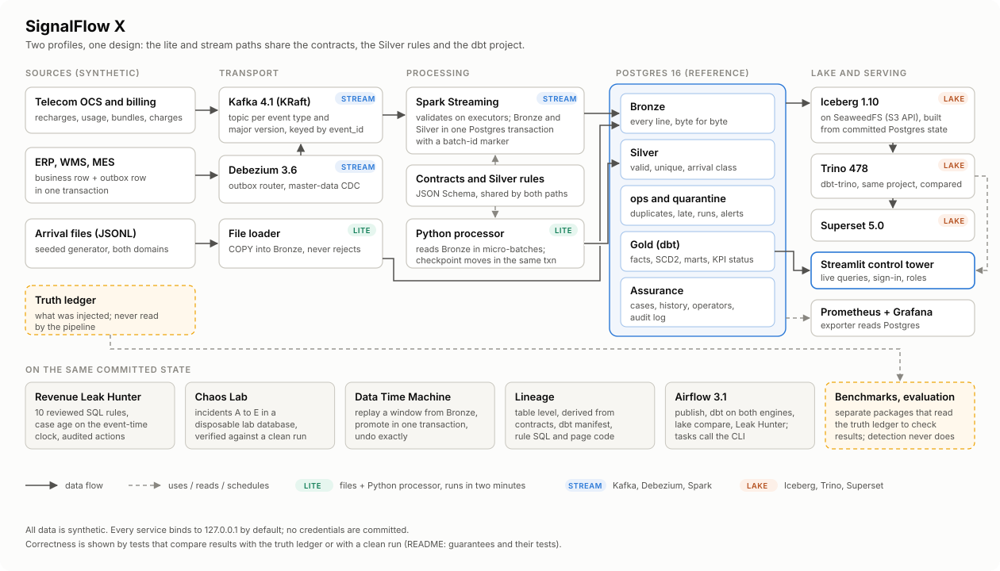

# SignalFlow X: interview guide

How to explain the project and its design choices in an interview. Every claim below points to the ADR, test or
report that backs it, so an interviewer who opens the repository finds the same thing you said.

## The two-minute version

SignalFlow X is a data platform for two simulated Bangladeshi companies: a mobile operator (recharges, billing,
usage, bundles, settlements) and an electronics manufacturer (orders, shipments, inventory, invoices, dealer
payments). A deterministic generator produces their events with the problems real feeds have: duplicates, late and
out-of-order arrivals, schema breaks, conflicting ids and business anomalies such as missing billing records or
double refunds. It also writes a ledger of everything it injected, which the pipeline never reads and the tests and
evaluations use as the answer key.

Events land byte for byte in Bronze, are validated against versioned JSON Schema contracts and deduplicated into
Silver in one transaction with the checkpoint, and dbt builds Gold marts on Postgres and, from the same project, on
Iceberg through Trino. The streaming path uses Kafka, a transactional outbox with Debezium for the ERP, and Spark
Structured Streaming. On top of that: a revenue leak hunter with an event-time case lifecycle, a chaos lab that
injects five incident types and proves recovery against a clean run, a time machine that replays any window from
Bronze, table-level lineage, Prometheus metrics, a benchmark suite, and a Streamlit control tower that shows all of
it from live queries.

The point is not the number of tools. It is that every guarantee is written down next to the test that
demonstrates it (README, "Guarantees and where they are tested").

## Architecture in one picture

Walk it left to right: sources → Bronze (append-only, everything kept) → Silver (contracts, dedup, lateness, one
transaction with the checkpoint) → Gold (dbt, both engines) → consumers. Then the column underneath: assurance,
reliability tooling, observability and benchmarks all read the same committed state.

## Design decisions you should be able to defend

| Decision | Why | Trade-off you accept | Evidence |
|---|---|---|---|
| Postgres is the reference implementation; the lake is published from committed Postgres state | One place where correctness is easy to prove. The lake can be rebuilt and compared row by row | Postgres is the bottleneck for volume; the lake is minutes behind | ADR-0001, ADR-0009, `lake compare` (23/23 Gold models identical) |
| Bronze accepts everything, byte for byte | You cannot fix what you did not keep. Replay and audit need the original line | Storage grows with garbage too | `test_bronze_keeps_every_line_verbatim` |
| Silver writes and the checkpoint move in one transaction | No partial batch can ever be visible; a crash resumes exactly | One writer per stream (row lock) | ADR-0006, `test_crash_mid_batch_then_resume_equals_clean_run`, Chaos Lab D |
| The watermark decides finality, not acceptance | Dropping late data loses money. Late events are accepted, labelled and the day restated | Dashboards must show PROVISIONAL / FINAL / RESTATED | ADR-0004, arrival-class test |
| Transactional outbox + Debezium for the ERP | Dual writes (DB then Kafka) lose or invent events on failure | Debezium and a replication slot to operate (and to watch: see the WAL story) | ADR-0003, master-data CDC test |
| Spark sink commits a batch-id marker in the same transaction | Kafka → Spark is at-least-once; the marker makes a replayed batch a no-op, so Postgres is effectively-once | Unbounded catch-up batches after downtime | ADR-0008, SIGKILL and exit-between-commits tests |
| Business rules in JSON Schema where possible, one Silver implementation for both paths | The lite processor and Spark cannot drift apart | Some rules (decimal places) stay in code | ADR-0002, stream tests require identical Silver fingerprints |
| Leak Hunter: SQL rules, case age on the event-time clock | Deterministic and reviewable; a delayed record is never called a leak before the late-data horizon | Confirmation waits 36 h (telecom) / 52 h (manufacturing) of stream time | ADR-0010, cadence-independence and benign-delay tests |
| Deterministic rules, not machine learning | The anomalies are defined business conditions with known counterparts; rules give exact evidence and zero training data needs | Rules only find what they describe | Phase 4 report, offline evaluation |
| Chaos Lab verifies against a clean run of the same dataset | "Recovered" must be checkable, not a status flag | Each run rebuilds a lab database (20 to 30 s) | ADR-0011, one integration test per incident |
| Time Machine replays from Bronze into a preview, promotes atomically, undoes exactly | Repair must be reviewable and reversible | It cannot recover records Bronze never received | ADR-0012, repair/undo tests |
| Lineage derived from code and the dbt manifest, table level | A hand-drawn graph drifts. Column-level would be a claim we cannot test | No column-level answers | ADR-0013, `COLUMN_LEVEL = False` test |
| Benchmarks run the real pipeline and check their own results | A fast wrong answer is worthless; numbers without the machine are meaningless | Only the lite path is benchmarked | ADR-0014, Benchmark Lab |

## Stories worth telling (problems found by testing)

1. **Batch durations were all zero.** `ops.processing_runs.finished_at` defaulted to `now()`, which in Postgres is
   the transaction start. Every batch looked instantaneous. Fixed with `clock_timestamp()`, guarded by a test.
2. **Kafka deleted the data within minutes.** Replayed events carried weeks-old timestamps, and the broker's
   time-based retention removed them. The simulated arrival time now travels in a header (ADR-0008).
3. **An idle CDC slot filled the disk.** The master-data connector had no heartbeat. Its replication slot sat still
   while the outbox moved, and Postgres kept 6.5 GB of WAL for it. Both connectors now emit heartbeats on a table in
   their own publication, the exporter reports retained WAL per slot, and Prometheus alerts above 1 GiB.
4. **The profile pointed at validation.** The Silver processor spent about two thirds of its time in jsonschema.
   Compiling the contracts made it 2.2 to 2.6 times faster across four workload sizes; jsonschema still decides every rejection, and a test proves both
   validators agree on 1,930 crafted variants (ADR-0014).
5. **A fixed number in a test.** The lake test asserted `PASS=100` dbt nodes; Phase 5 added models and CI failed.
   The test now compares the lite and lake builds with each other, which is what it meant.

## Numbers (from the Benchmark Lab)

Quote numbers with their machine. The Phase 6 report has the full table; the short version for the 4-vCPU, 15 GB
build machine is in [PHASE6_REPORT.md](reports/PHASE6_REPORT.md#headline-results). Say what limits them: one Python
processor process (about one core), Postgres on the same host, and a full dbt rebuild for Gold freshness.

## Questions you will probably get

**"Is this production-ready?"** No, and the README says so. It uses production technologies and production
patterns, and its failure behaviour is tested, but it runs on one machine, Kafka has one broker, nothing is
replicated, Trino has no authentication, and there is no on-call or capacity plan.

**"Exactly-once?"** Not end to end. Kafka → Spark is at-least-once. Postgres ends up effectively-once because each
batch commits a marker in the same transaction (ADR-0008) and Bronze has a unique source position.

**"What happens at 100× the volume?"** Measured today: the processor is CPU-bound in one Python process, and Gold is
a full dbt rebuild. Next steps, in order: partition the checkpoint by stream (or by key range) so several
processors can run; make the large Gold models incremental in dbt; move Bronze retention to the lake and keep only
recent Bronze in Postgres; let the Spark path carry the volume, since it already validates on executors.

**"Why not just use Spark for everything?"** The lite path runs anywhere in two minutes and is the reference the
Spark path is tested against. Both use the same Silver code.

**"How do you know the dashboards are right?"** Gold revenue equals the generator's ledger to the poisha; a dbt test
reconciles the revenue mart to Silver; the lake's Gold equals Postgres Gold row by row; the benchmark re-checks revenue,
stock, Silver contents and settlement reconciliation at every workload size it runs.

**"Where would AI help?"** An assistant that explains a Leak Hunter case from its evidence, or drafts an incident
summary from a Chaos Lab report, would be useful. It was not built: the master plan allowed it only once the core was
complete and correct, and every number on screen had to stay deterministic. It would sit on top of the existing
evidence, never decide a case.

## What not to say

* "Real-time": the lite path processes per arrival file; the streaming path per micro-batch. Say "micro-batch" and
  quote the measured latency.
* "Scales linearly": say what was measured, on which machine, over which range of workload sizes.
* "Fault-tolerant": say which failures were injected and what the tests check afterwards.
