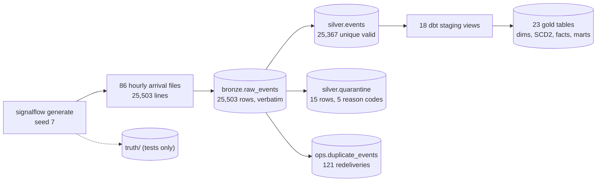

# Phase 1 Report — Functional Data Foundation (lite profile)

Date: 2026-10-21. Environment: cloud Linux container, 4 vCPU, 15 GB RAM, Python 3.12, PostgreSQL 16.15 in Docker
(`mirror.gcr.io/library/postgres:16-alpine`), dbt-core 1.11.16 / dbt-postgres 1.11.0.

## What now works



| Component | Path | Notes |
|-----------|------|-------|
| Generator | `src/signalflow/generator/` | seed-controlled; telecom (subscribers, recharges, billing, bundles, usage, settlements) and manufacturing (production, inventory, orders, shipments, invoices, settlements, returns, refunds, cycle counts, transfers, disruptions); Dhaka hourly demand curve, Fri/Sat effects, regional weights; writes a separate truth ledger |
| Injected scenarios | `generator/transport.py`, simulators | late (within / beyond watermark), redelivery duplicates, 5 kinds of schema break, event-id conflicts, a truncated line; business anomalies for Phase 4 (missing billing, double charge, activation without capture, settlement mismatch, shipment without invoice, dealer short payment, double refund, unauthorized adjustment) |
| Schema | `sql/migrations/001_foundation.sql` | `bronze`, `silver`, `ops`, `ref`; migrations tracked in `ops.schema_migrations` under an advisory lock |
| Bronze loader | `src/signalflow/ingest/bronze_loader.py` | COPY into a staging temp table, then `INSERT … ON CONFLICT (source_stream, source_position) DO NOTHING` |
| Silver processor | `src/signalflow/processing/silver.py` | contract validation, quarantine, dedupe vs conflict, lateness classification, restatement log, transactional checkpoint, single-writer lock, guarded fault injection |
| Gold | `dbt/` | `dim_date` (Dhaka, Fri/Sat weekend), `dim_subscriber_scd2`, 5 other dims, 9 facts, 6 marts; KPI finality column on marts |
| Data tests | `dbt/models/gold/schema.yml`, `dbt/tests/` | 100 dbt nodes incl. 7 singular reconciliation/consistency tests |
| CLI | `signalflow generate / migrate / run / status` | |
| Deployment | `docker-compose.yml` (`lite` profile), `.env.example`, `Makefile` | Postgres bound to 127.0.0.1, health check, 1 GB memory limit, `wal_level=logical` ready for Debezium |
| CI | `.github/workflows/ci.yml` | ruff, mypy (strict), unit tests, E2E against a Postgres service container (not yet run on GitHub: no repository attached) |

## Test results (real runs, 2026-10-21)

```
$ make test
ruff check src tests            -> All checks passed!
mypy src (strict)               -> Success: no issues found in 18 source files
pytest tests/unit -q            -> 96 passed in 1.73s
pytest tests/integration -q -rA -> 14 passed in 48.41s
```

End-to-end acceptance tests (all PASSED, against a fresh database per scenario):

| Test | What it proves |
|------|----------------|
| `test_dbt_build_passes_all_models_and_tests` | `dbt build`: PASS=100 WARN=0 ERROR=0 |
| `test_bronze_keeps_every_line_verbatim` | 25,503 lines → 25,503 Bronze rows; the unparseable line is stored with `parse_error`; stored text equals file text |
| `test_silver_contains_exactly_the_valid_unique_events` | Silver event-id set equals the generator's valid set (25,367) |
| `test_quarantine_matches_injected_breaks` | quarantine counts by reason equal the injected breaks |
| `test_technical_duplicates_logged_not_counted` | 121 redeliveries logged, none in Silver |
| `test_arrival_classes_follow_documented_batch_watermark_semantics` | independent re-computation from the files matches all 25,367 classifications |
| `test_no_unplanned_lateness` | no event the generator did not delay is classified late |
| `test_gold_revenue_equals_truth_to_the_poisha` | revenue by date × channel × region equals truth exactly |
| `test_gold_inventory_equals_truth` | on-hand per warehouse × SKU equals truth |
| `test_settlement_reconciliation_exposes_injected_mismatch` | exactly the injected short settlement shows a non-zero difference |
| `test_replaying_all_files_changes_nothing` | full replay inserts 0 Bronze rows, accepts 0 Silver rows, all fingerprints unchanged |
| `test_crash_mid_batch_then_resume_equals_clean_run` | abort after writes and before commit → nothing visible, checkpoint unchanged; resume → Silver, quarantine, ops state and 7 Gold tables byte-identical (md5) to the clean run |
| `test_second_processor_is_refused_while_first_holds_the_checkpoint` | concurrent processor gets `ProcessorBusy` instead of double-processing |
| `test_fault_injection_is_disabled_by_default` | the fault hook cannot be triggered without an explicit env flag |

**Do the tests catch real faults?** Two checks were done by hand, not just assumed:
1. A mutant processor that advanced the stream clock per row instead of per batch was caught by two E2E tests.
2. During development the data tests caught two genuine bugs, both fixed: the generator let new subscribers
   recharge before their activation time (caught by `not_null` on `fct_recharge.subscriber_sk`), and the
   `kpi_status` macro bound an unqualified column to the wrong table, marking every day `RESTATED` (caught while
   checking the mart against `ops`; a dedicated test now guards it). The E2E suite also exposed that the first
   version ran micro-batches as savepoints inside one long transaction; connections are now autocommit and the
   processor refuses non-autocommit connections.

## Demo data (seed 7, 3 business days, 2,000 subscribers, 150 dealers)

Revenue by business day, with finality:

| business_date | kpi_status | successful | failed | gross BDT | successful without billing |
|---|---|---|---|---|---|
| 2026-10-01 | RESTATED | 721 | 22 | 108,760.00 | 1 |
| 2026-10-02 | RESTATED | 531 | 14 | 83,350.00 | 5 |
| 2026-10-03 | PROVISIONAL | 661 | 17 | 100,300.00 | 1 |

Oct 1–2 are `RESTATED` because 28 telecom events arrived more than 6 h behind the stream clock after those days
were final; Oct 3 is `PROVISIONAL` because the watermark has not passed its end. Oct 2 (a Friday) is visibly lower.

Channel settlement reconciliation finds exactly one discrepancy: `STL-RETAIL_AGENT-20261002`, expected
23,190.00 BDT, settled 22,749.39 BDT, difference −440.61 BDT. Inventory shows 2 adjustments with
`NO_APPROVAL_FOUND`, and 1 SKU out of stock at the central warehouse.

Measured footprint: Postgres container 323 MiB RSS after the run; database 53 MB; generated files 13 MB; `make run`
(ingest 86 files + process + dbt build) 16 s wall clock. These are single-run figures, not a benchmark; Phase 6 adds
a proper benchmark with repeated runs and percentiles.

## Known limitations (honest list)

* **Lite profile only.** No Kafka, Debezium, Spark, Iceberg yet (Phases 2–3). The transport is replayed files.
* **Gold is fully rebuilt** on each `dbt build`. Correct by construction for late data, but cost grows with history;
  incremental models with a measured baseline come in Phase 3.
* **Python Silver processor is single-writer** by design (row lock). Throughput is not yet measured.
* **`dim_dealer` is type 1**; dealer history needs the ERP CDC feed (Phase 2).
* **Revenue Leak Hunter is not implemented.** Phase 1 only exposes the raw reconciliation facts (settlement
  difference, unbilled recharges, unapproved adjustments). Case lifecycle, pending-vs-confirmed logic, exposure
  estimates and precision/recall against the ledger are Phase 4.
* **CI has not run on GitHub yet** because no repository is attached; the same commands pass locally.
* **Scenario guarantee:** for small demo runs the generator forces the first opportunity of each business anomaly,
  so every scenario appears. Very short windows (e.g. 1 day) still cannot contain returns or settlements.
* Gap to a real deployment (unchanged from REQUIREMENTS §3): HA, TLS, secrets manager, IdP-based RBAC,
  backup/restore drills, retention policy, capacity testing on real hardware.

## How to demonstrate

```bash
cp .env.example .env              # choose a local password
make setup                        # Python 3.12 venv + dependencies
make up                           # PostgreSQL (lite profile), waits for health check
make generate                     # data/seed7, deterministic
make run                          # bronze -> silver -> dbt build (100 models/tests)
make status                       # counts, quarantine by reason, watermarks
make test                         # lint, type check, 96 unit + 14 end-to-end tests
```

Then, in `psql`:

```sql
-- KPI finality and revenue
select business_date, kpi_status, sum(gross_recharge_bdt) from gold.mart_telecom_revenue_daily group by 1,2 order by 1;
-- reconciliation
select settlement_id, expected_amount_bdt, settled_amount_bdt, difference_bdt from gold.fct_channel_settlement;
-- why was something rejected? (bronze_id links back to the raw line)
select q.reason_code, q.details, b.source_position from silver.quarantine q join bronze.raw_events b using (bronze_id);
-- SCD2 history
select * from gold.dim_subscriber_scd2 where subscriber_id = 'SUB-0001711' order by valid_from;
```

## Next: Phase 2 (streaming)

Starts with a version spike (Kafka 4.1 KRaft + Debezium + Spark 4.0/3.5 + Kafka connector) in Docker before any
streaming code, then the telecom Kafka producer, ERP outbox + Debezium, and Spark Silver jobs whose output is tested
against this Phase 1 reference on the same seed.
