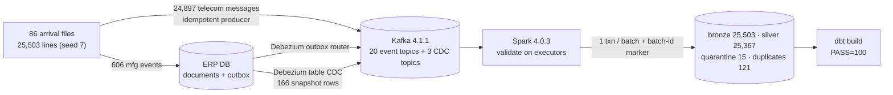

# Phase 2 Report — Streaming (Kafka, Debezium CDC, Spark Structured Streaming)

Date: 2026-10-22. Environment: cloud Linux container, 4 vCPU, 15 GB RAM, Docker 27, Python 3.12, Java 21 (host
Spark), PostgreSQL 16 (`postgres:16-alpine`), Kafka 4.1.1 KRaft, Kafka Connect 4.1.1 with Debezium 3.6.3.Final,
PySpark 4.0.3 in local mode (`local[2]`), confluent-kafka 2.12.0.

## What now works



| Component | Path | Notes |
|-----------|------|-------|
| Version spike | `scripts/fetch_artifacts.sh`, ADR-0005 | Debezium 3.x images are only on quay.io (unreachable here), so Connect is built from the official Kafka 4.1.1 image + the Debezium 3.6.3 plugin from Maven Central; every artifact is SHA-1 checked; retries with backoff for Maven's HTTP 429 |
| Compose `stream` profile | `docker-compose.yml`, `docker/connect/` | Kafka (KRaft, auto-create off, loopback-bound), Connect + Debezium (health check, memory limit); Spark job image in profile `stream-job` |
| Topics | `streaming/topics.py` | one topic per event type × major version, plus `<domain>.unrouted.v1`; created from the contract registry; Spark subscribes by pattern |
| Telecom producer | `streaming/replay.py` | idempotent (`acks=all`), key = `event_id`; arrival time in header `sf_arrival_time`; a damaged line goes to `telecom.unrouted.v1` verbatim |
| ERP + outbox | `erp.py`, `sql/erp/001_erp.sql` | business document upsert and outbox insert in one transaction; master data tables with `REPLICA IDENTITY FULL` |
| Debezium | `streaming/connect.py` | outbox connector (Outbox Event Router, routes by `aggregatetype`, key = `aggregateid` = `event_id`, heartbeat action query so the slot never pins WAL) and master-data connector (table CDC, JSON); password via `${env:CDC_PASSWORD}`; dedicated `LOGIN REPLICATION` role |
| Spark job | `streaming/spark_silver.py` | two queries: `silver_events` (pattern subscription, `mapInPandas` validation, `foreachBatch` sink) and `master_data`; processing-time or `availableNow` trigger |
| Sink | `streaming/sink.py` | one Postgres transaction per micro-batch: Bronze (`kafka:<topic>`, `<partition>:<offset>`), Silver via the shared `apply_validated`, `ops.stream_commits(batch_id)`; replays recorded in `ops.stream_replays`; single writer per query (advisory lock) |
| Shared Silver rules | `processing/silver.py` | refactored so lite and streaming call the same `apply_validated`; all Phase 1 tests still pass |
| Lifecycle | `streaming/admin.py`, `signalflow stream …`, `make stream-*` | init (idempotent), status (connector state, slot lag, counts), teardown (connectors with offset reset, slots, publications, topics, checkpoints; databases only with `--drop-databases --yes`) |
| CI | `.github/workflows/ci.yml` job `stream` | compose `stream` profile + Java 17 + `tests/stream` with `SIGNALFLOW_REQUIRE_STREAM=1`, then builds the Spark image |

## Test results (real runs, 2026-10-22)

```
ruff check src tests                    -> All checks passed!
mypy src (strict)                       -> Success: no issues found in 30 source files
pytest tests/unit -q                    -> 105 passed in 2.86s
pytest tests/integration -q             -> 15 passed in 60.06s
pytest tests/stream -q -rA              -> 5 passed in 391.81s
  PASSED test_spark_sigkill_mid_stream_then_restart_equals_lite_reference
  PASSED test_exit_between_our_commit_and_sparks_commit_is_replayed_as_a_noop
  PASSED test_failure_inside_a_batch_rolls_back_and_the_retry_completes
  PASSED test_duplicate_storm_leaves_silver_and_gold_unchanged
  PASSED test_master_data_change_is_captured_by_cdc
```

| Stream test | What it proves |
|-------------|----------------|
| `test_spark_sigkill_mid_stream_then_restart_equals_lite_reference` | Spark (driver + JVM process group) is SIGKILLed after ≥2 committed batches **while records are still arriving**; after restart: Silver event-id+hash fingerprint, quarantine fingerprint and duplicate count equal the lite run on the same seed; 25,503 Bronze rows with 25,503 distinct positions; batch ids contiguous; no event late unless the generator delayed it; `dbt build` on the stream DB passes and revenue (date × channel × region, in poisha) and inventory equal the generator's truth |
| `test_exit_between_our_commit_and_sparks_commit_is_replayed_as_a_noop` | process exits right after Postgres committed batch 1 (exit code 70); on restart Spark re-executes batch 1, the sink records exactly one skipped replay (`ops.stream_replays = [(1)]`) and the final state equals the reference |
| `test_failure_inside_a_batch_rolls_back_and_the_retry_completes` | an exception inside batch 0's transaction: job exits 1, Bronze and commit table are empty; the retry completes and equals the reference |
| `test_duplicate_storm_leaves_silver_and_gold_unchanged` | every recharge record re-sent 3 more times (3 × 1,984 = 5,952 messages): Silver fingerprint unchanged, duplicates grow by exactly 3 × valid copies, quarantine grows by exactly 3 × invalid copies, recharge event set unchanged |
| `test_master_data_change_is_captured_by_cdc` | initial snapshot = 150 + 12 + 4 rows; an ERP dealer update arrives in `bronze.master_data_changes` with op `u` and correct before/after values |

Unit additions (`tests/unit/test_streaming_units.py`, 9 tests): routing by type and major version, unrouted cases,
every topic matches the Spark pattern while CDC topics do not, wrapper parsing keeps damaged lines verbatim,
connectors carry no secrets, arrival-time header precedence, offset summaries.

## Demo run (seed 7, streaming while replaying)

Spark started first (`signalflow stream silver --trigger-seconds 2`), then `signalflow stream replay --pace-ms 200`.

| Measure | Value | Source |
|---------|-------|--------|
| Replay | 86 files, 24,897 telecom messages + 606 ERP events in 20.7 s (200 ms pause per file) | CLI output |
| Debezium routing | 606 outbox rows → 11 manufacturing topics, counts per topic equal to the ERP writes | `kafka-get-offsets.sh` |
| Micro-batches | 5 committed (batch 0 empty, then 2,343 / 8,139 / 13,236 / 1,785 records) | `ops.stream_commits` |
| Postgres part of a batch | p50 625 ms, max 2,117 ms | `ops.processing_runs` |
| Lag at end of replay | roughly 15 s: the replay ran 20.7 s from about the time of the empty batch 0 (06:29:11); the last batch committed at 06:29:47 | commit timestamps, replay duration (estimate) |
| Result | Bronze 25,503 · Silver 25,367 · quarantine 15 (same 5 reasons and counts as lite) · duplicates 121 | `stream status` |
| Gold | `dbt build` PASS=100 on the stream DB; revenue per day 108,760.00 / 83,350.00 / 100,300.00 BDT, equal to lite | `gold.mart_telecom_revenue_daily` |

KPI finality differs and that is expected: with 5 large batches instead of 86 file-sized ones, 1 Oct is `FINAL` in the
streaming run and `RESTATED` in the lite run (fewer beyond-watermark arrivals were observed: 20 vs 44). Revenue
figures are identical; only the finality label depends on batch boundaries (ADR-0004, ADR-0008).

Throughput note, not a benchmark: in this local-mode setup a 13k-record batch took about 14 s end to end, i.e.
roughly 1,000 records/s, slower than the single-process lite path. Per-batch overhead (Python workers, Arrow
transfer, collect to driver) dominates at this volume. Controlled measurements are Phase 6.

## Problems found while testing, and fixes

1. **Kafka deleted replayed data.** The first producer set each record's Kafka timestamp to the simulated arrival
   time (three weeks ago). The broker's 7-day time-based retention removed those segments within minutes, and
   Spark correctly failed with "Some data may have been lost". Fix: the simulated time travels in a header; the
   Kafka timestamp is produce time.
2. **Re-created connectors resumed from stale offsets.** After teardown (slot dropped) and init with the same
   connector name, Debezium resumed from the old LSN and its task failed a few seconds after reporting RUNNING.
   Fix: teardown stops the connector, deletes its offsets (KIP-875 REST API), then deletes it; init waits until
   tasks stay RUNNING.
3. **Batch durations were always ~0 ms in the lite path** (found during the UI preview): `finished_at` used
   `now()`, which is the transaction start. Fixed with `clock_timestamp()` and a test.

## Limitations (honest list)

* Single Kafka broker, replication factor 1, single Connect worker: no broker fault tolerance is claimed.
* The streaming sink collects each micro-batch on the driver; batch size is unbounded during catch-up (on purpose,
  see ADR-0008). Phase 3 replaces the Postgres sink with Iceberg writes from the executors.
* Kafka → Spark is at-least-once; the Postgres result is effectively-once per Kafka record. No end-to-end
  exactly-once claim.
* The source simulator is the attributed origin of the one damaged line (telecom); the ERP never writes damaged
  JSON.
* Master-data CDC lands raw in Bronze; turning it into SCD2 dealer/product dimensions is Phase 4 (digital twin).
* (Resolved in Phase 3: the image now builds here, see PHASE3_REPORT.) The Spark job image could not be built in this environment (its package mirror refuses plain HTTP through the
  proxy); it is built in the CI `stream` job instead. The test suite runs Spark on the host.
* Plain-text PLAINTEXT listeners, no TLS/SASL: acceptable only because every port is bound to 127.0.0.1.

## Demo instructions

```bash
make stream-up && make stream-init
make stream-silver                       # terminal 1
make stream-replay PACE_MS=200           # terminal 2
make stream-status                       # counts, committed batches, slot lag
make stream-transform                    # dbt gold on the streaming DB
# crash it: Ctrl-C (or kill -9) the Spark job mid-replay, start it again, compare `stream status` with `make status`
make test-stream                         # the automated version of all of the above
```
