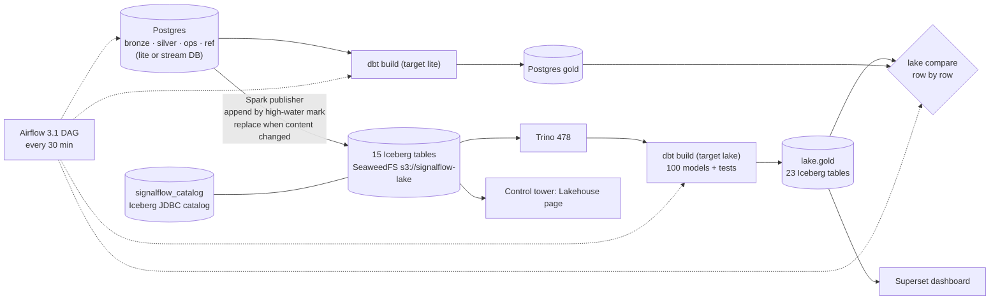

# Phase 3 Report — Lakehouse (Iceberg, Trino, dbt-trino, Airflow, Superset)

Date: 2026-10-22. Environment: cloud Linux container, 4 vCPU, 15 GB RAM, Docker 27, Python 3.12, Java 21 (host
Spark), PostgreSQL 16, SeaweedFS 3.97 (S3 API), Iceberg 1.10.1 (Spark 4.0 runtime, JDBC catalog), Trino 478,
dbt-core 1.11.16 + dbt-trino 1.10.6, Airflow 3.1.0, Superset 5.0.0.

## What now works



| Component | Path | Notes |
|-----------|------|-------|
| Decision record | `docs/adr/0009-…` | the lake is published from committed Postgres state; Silver is still decided in one place (ADR-0008) |
| Publisher (Spark) | `lakehouse/publish.py`, `lakehouse/tables.py` | 15 tables. Append tables: rows above `max(mark column)` in the Iceberg table, bounded by the source max at run start, one snapshot per table per run with `signalflow.hwm` in the summary. Replace tables: whole table, only when the content MD5 changed. Refuses to mix two source databases in one table. |
| Catalog + storage | `docker-compose.yml` (`lake`), `docker/trino/`, `docker/seaweedfs/` | Iceberg JDBC catalog in Postgres DB `signalflow_catalog`; SeaweedFS S3 gateway with keys from `.env`; one-shot bucket creation; all ports on 127.0.0.1 |
| dbt on two engines | `dbt/macros/dhaka.sql`, `dbt/macros/staging.sql`, `dbt/profiles.yml` | adapter-dispatched macros for time zones, JSON fields, exact decimal division, epoch differences, MD5, date series, SCD2 open end; target `lake` on Trino with `on_table_exists: replace` |
| Differential check | `lakehouse/compare.py`, `signalflow lake compare` | every Gold model, multiset comparison after normalising UUID/text, decimal scale and time zones; result stored in `ops.lake_differential_checks` |
| Maintenance | `lakehouse/admin.py`, `signalflow lake maintain` | `rewrite_data_files` (min 2 input files) and `expire_snapshots` (older than 7 days, keep last 50) |
| Airflow | `airflow/dags/signalflow_lakehouse.py`, `docker/airflow/` | `publish → dbt_build_lake`, `dbt_build_postgres`, both → `differential_check`; daily maintenance DAG. LocalExecutor, metadata DB in Postgres, CLI in its own virtualenv inside the image |
| Superset | `bi/superset.py`, `docker/superset/` | Trino connection, 4 datasets, 9 charts and one dashboard created by `signalflow bi bootstrap` (idempotent); SignalFlow palette and status colours registered in `superset_config.py` |
| Control tower | `ui/app.py` (Lakehouse page) | tables, rows, snapshots, snapshot history, publication runs and the last differential check, all queried live (Trino + `ops.*`) |
| CI | `.github/workflows/ci.yml` job `lake` | compose `lake` profile, `tests/lake` with `SIGNALFLOW_REQUIRE_LAKE=1`, Airflow image + `airflow dags test`, Superset image build |

## Test results (real runs, 2026-10-22)

```
ruff check src tests                    -> All checks passed!
mypy src (strict)                       -> Success: no issues found in 39 source files
pytest tests/unit -q                    -> 110 passed in 3.05s
pytest tests/integration -q             -> 15 passed in 68.76s
pytest tests/stream -q -rA              -> 5 passed in 412.41s   (after the connection fix below)
pytest tests/lake -q -rA                -> 2 passed in 334.70s
  PASSED test_incremental_publication_then_dbt_on_trino_equals_lite_gold
  PASSED test_publisher_killed_mid_write_and_between_tables_publishes_each_row_once
```

| Lake test | What it proves |
|-----------|----------------|
| `test_incremental_publication_then_dbt_on_trino_equals_lite_gold` | lite pipeline on the first half of the arrival files → publish → second half → publish. After each run every one of the 15 tables matches Postgres (row count and distinct-key count) and the Silver fingerprint (event id + event hash) is identical. `silver.events` has exactly two append snapshots with increasing high-water marks and `added-records` equal to the increment. A third run adds **no snapshot to any table**. Then `dbt build` on Postgres and on Trino (PASS=100) and all **23 Gold models identical row by row**, gross revenue totals equal. Finally `lake maintain` compacts: fingerprint and counts unchanged, newest snapshot is a `replace`. |
| `test_publisher_killed_mid_write_and_between_tables_publishes_each_row_once` | (1) SIGKILL of the Spark driver and JVM 1.5 s after the `silver.events` write starts (asserted still running): the table shows 0 rows, Bronze (committed earlier in the run) is there. (2) Fault hook exits with code 70 right after `silver.events` commits: Silver complete, later tables untouched. (3) A normal run completes: every table equals Postgres, and `silver.events` has exactly **one** append snapshot (the recovery run did not append again). |

Unit additions (`tests/unit/test_lakehouse_units.py`, 4 tests): every append spec selects its high-water-mark,
sort and partition columns; JSON and UUID columns are published as text; normalisation rules of the differential
check (UUID vs text, decimal scale, time zones; naive timestamps rejected). `test_streaming_units.py` gained the
per-thread connection regression test below.

Airflow:

| Run | Where | Result |
|-----|-------|--------|
| `airflow dags test signalflow_lakehouse` | host, Airflow 3.1.0 in a separate venv, SQLite metadata | DagRun `state=success`, 77.6 s |
| scheduled run (on unpause) | compose: api-server, scheduler (LocalExecutor), dag-processor, Postgres metadata | success, 61.5 s: publish 31.6 s, dbt Postgres 22.5 s, dbt Trino 22.9 s, compare 4.6 s |
| manual run (REST API trigger) | compose | success, 53.1 s: publish 24.3 s, dbt Postgres 12.5 s, dbt Trino 21.2 s, compare 5.6 s |

## Demo run (seed 7, lite database `signalflow`)

| Measure | Value | Source |
|---------|-------|--------|
| First publication | 15 tables, 51,323 rows (Bronze 25,503, Silver 25,367, …) in 54.7 s wall clock including Spark start-up; `silver.events` 25.7 s (day-partitioned, sorted), `bronze.raw_events` 9.6 s | publisher JSON output |
| Second publication, nothing new | 15 × "no new committed rows" / "unchanged", 0 snapshots added | publisher output, `$snapshots` |
| dbt on Trino | PASS=100 in about 30 s | dbt output |
| Differential check | 23 / 23 Gold models identical (dim_date 1,188 rows … fct_usage 17,577 rows) | `ops.lake_differential_checks` |
| Compaction | `bronze.raw_events` and `silver.events` got a `replace` snapshot (files rewritten), row counts unchanged | `lake maintain`, `lake status` |
| Memory, everything running | Trino 1.83 GiB, Postgres 0.81 GiB, Airflow 1.33 GiB (3 containers), Kafka 0.59 GiB, Connect 0.44 GiB, Superset 0.26 GiB, SeaweedFS 0.12 GiB ≈ 5.4 GiB | `docker stats`, idle after runs |

Screenshots of the Superset dashboard, the Airflow DAG and the control tower Lakehouse page were taken from these
running services (shared in the project thread, not committed).

## Problems found while building, and fixes

1. **Phase 2 CI failure: two streaming queries shared one Postgres connection.** Spark runs each query's
   `foreachBatch` on its own driver thread; on the GitHub runner the master-data batch's `executemany` (pipeline
   mode) overlapped an events batch's `COPY` ("COPY cannot be used in pipeline mode"). Beyond the error, their
   transactions could interleave. Fix: one connection per thread, regression test added. It passed locally only
   because the timing never overlapped there.
2. **Every Iceberg file read back corrupt.** AWS SDK v2 (2.30+) uploads with `aws-chunked` encoding and trailing
   CRC checksums by default; SeaweedFS 3.97 stored the chunk framing in the object (`Not an Avro data file`,
   `Unexpected character ('f')`). Fix: `AWS_REQUEST_CHECKSUM_CALCULATION` / `AWS_RESPONSE_CHECKSUM_VALIDATION =
   WHEN_REQUIRED` for Spark and Trino (ADR-0009).
3. **Trino could not create schemas** (`relation "iceberg_tables" does not exist`): Trino's JDBC catalog does not
   create the catalog tables. The Spark publisher initialises them (`jdbc.schema-version=V1`) on first use.
4. **Superset showed an empty dashboard.** `json_metadata.positions` overrides `position_json` and the chart list;
   an empty `positions` detached all charts. Fix: send the layout in both.
5. **Airflow init could not create its own database.** The image's entrypoint waits for the metadata DB before
   running the command; the init container now skips that wait (`CONNECTION_CHECK_MAX_COUNT=0`). The auth volume
   is pre-created with the `airflow` user as owner.
6. **Spark image could not be built here** (Phase 2 limitation): the JRE is now copied from the Temurin image
   instead of `apt-get`, and the optional CA bundle for TLS-intercepting proxies is a BuildKit secret, so the
   Spark, Airflow and Superset images all build in this environment (`scripts/docker_build_behind_proxy.sh`).
7. **Disk full during the full-suite run.** The first full run failed both lake tests with S3 HTTP 500: the
   container's disk allowance was spent (Docker build cache), and SeaweedFS refuses writes below 1 % free. After
   pruning the build cache the same tests passed (the 334.70 s run above). Nothing in the code changed.
8. **Postgres-only SQL in dbt**: `'infinity'::timestamptz`, `array_agg(...)[1]`, `generate_series`,
   `extract(epoch …)`, `::numeric` division, `USING` with qualified columns in a test. Each became a dispatched
   macro or portable SQL; SCD2 open intervals now end at `9999-12-31 00:00 UTC` on both engines.

## Limitations (honest list)

* Lake freshness is the Airflow interval plus about a minute; the lake is for analytics, not operational reads.
* The append high-water mark relies on single-writer identity columns (true for every writer today; see ADR-0009).
* No multi-table atomicity in Iceberg: within one publication run, tables commit one after another.
* Killed writes leave orphan files in S3; orphan removal is manual (unsafe with an active writer).
* Trino and Superset have no TLS and Trino has no authentication: acceptable only because every port is bound to
  127.0.0.1. Airflow uses its Simple auth manager with a generated admin password.
* The Spark publisher runs in local mode inside the Airflow scheduler container (LocalExecutor); a real deployment
  would submit it to a Spark cluster.
* Superset charts are built for seed-7 volumes (a few days of data); no Superset alerting or row-level security.
* Iceberg catalog is the JDBC catalog in Postgres, not a REST catalog with access control.

## Demo instructions

```bash
make run                                   # lite pipeline (Phase 1) if not done yet
make lake-up && make lake-publish          # 15 Iceberg tables
make lake-transform && make lake-compare   # Gold on Trino, compared with Postgres Gold
make lake-publish                          # again: nothing new, no snapshot added
make airflow-up                            # http://127.0.0.1:58081 (admin / `make airflow-password`), unpause the DAG
make superset-up && make superset-bootstrap  # http://127.0.0.1:58088/superset/dashboard/signalflow-lakehouse/
make ui                                    # control tower → Platform → Lakehouse
make test-lake
```
