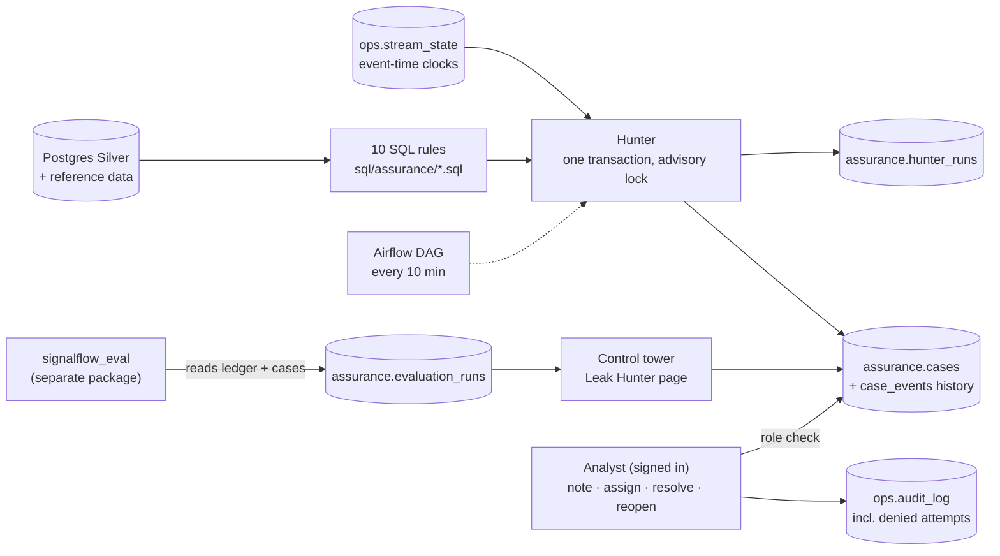

# Phase 4 Report: Revenue Leak Hunter and Enterprise Digital Twin

Date: 2026-10-22. Environment: cloud Linux container, 4 vCPU, 15 GB RAM, Docker 27, Python 3.12, PostgreSQL 16,
dbt-core 1.11, Airflow 3.1.0, Streamlit 1.50.

## What now works



| Component | Path | Notes |
|-----------|------|-------|
| Decision record | `docs/adr/0010-…` | SQL rules, event-time aging, late-data horizon, lifecycle, evaluation kept outside detection |
| Rules | `sql/assurance/*.sql`, `assurance/rules.py` | 5 telecom and 5 manufacturing rules. Every rule returns the same columns and its evidence names the transactions involved. Each rule's SQL sha256 is stored in `assurance.rules`. |
| Hunter | `assurance/hunter.py` | One transaction per run. Cases are opened, escalated (pending → suspicious → confirmed by rule), auto-cleared when the counterpart arrives, and reopened if a gap returns. Analyst resolutions are kept. Each run writes a row to `hunter_runs`. |
| Case actions | `assurance/cases.py` | Note, assign, resolve (needs a code and a note), reopen. Each action uses `SELECT … FOR UPDATE`, an optimistic version check, a history row and an audit row, all in one transaction. |
| Security | `security.py`, migration `004_assurance.sql` | Operators with roles viewer < analyst < operator < admin. Passwords are stored as scrypt hashes. Unknown users are checked against a dummy hash so the response takes the same time. Every attempt, including denied ones, is written to `ops.audit_log`. |
| Generator | `generator/telecom.py`, `generator/manufacturing.py` | New *benign* scenarios: billing delayed by 2–20 h, dealers paying up to 3 days after the due date, plus dealer non-payment (a real leak). All are ledgered, so the evaluation can check that delays are never confirmed. |
| Evaluation | `src/signalflow_eval/leak_hunter.py` | Matches cases to the scenario ledger and reports precision and recall of *confirmed* cases per rule, plus benign checks. Results are recorded in `assurance.evaluation_runs`. Detection never imports this package (unit test). |
| CLI | `signalflow assurance {hunt,cases,show,note,assign,resolve,reopen}`, `signalflow operators …` | Passwords come from a prompt or an environment variable, never from an argument. |
| Airflow | `airflow/dags/signalflow_leak_hunter.py` | `signalflow assurance hunt` every 10 min on the streaming database. Also run in CI with `airflow dags test`. |
| Control tower | `ui/leak_hunter.py`, `ui/app.py`, `ui/auth.py` | **Leak Hunter page:** tiles, filters, a trend by business date, exposure by business unit, a rules table with a horizon check, the case list, case inspection (evidence, raw Bronze bytes, history), analyst actions gated by role, and the evaluation panel. **Digital twin pages:** telecom and manufacturing state at the stream clock. **Every section is labelled** as stored fact, derived metric, projection or estimate. Optional live refresh every 15 s. |
| Makefile | `hunt`, `cases`, `evaluate`, `operator`, `generate DAYS=… SUBSCRIBERS=…` | |

### The rules

| Rule | Checks | Pending while younger than | Confirmed after |
|------|--------|----------------------------|-----------------|
| TEL-01 | successful recharge with no billing record | 15 min | 36 h |
| TEL-02 | the same payment captured twice | immediately suspicious | 36 h |
| TEL-03 | bundle activated without a captured payment | 15 min | 36 h |
| TEL-04 | channel settlement differs from expected revenue | immediately suspicious | 36 h |
| TEL-05 | billing charge without a successful recharge (delay detector) | 15 min | 36 h |
| MFG-01 | shipment without an invoice | 2 h | 2 d 4 h |
| MFG-02 | dealer settlement differs from the invoice | immediately suspicious | 2 d 4 h |
| MFG-03 | return refunded twice | immediately suspicious | 2 d 4 h |
| MFG-04 | inventory adjustment without an authorized source | 1 h | 2 d 4 h |
| MFG-05 | invoice unpaid past its due date (window starts at the due date) | 3 d | 5 d 4 h |

The late-data horizon is 36 h for telecom and 52 h for manufacturing. Both exceed the platform's largest accepted
lateness (30 h and 48 h) and the longest benign delay (billing 20 h). `test_horizons_exceed_every_delay_the_platform_accepts`
asserts these inequalities against the generator's own constants.

## Test results (real runs, 2026-10-22)

```
ruff check src tests                    -> All checks passed!
mypy src (strict)                       -> Success: no issues found in 49 source files
pytest tests/unit -q                    -> 127 passed in 3.78s
pytest tests/integration -q -rA         -> 21 passed in 154.72s   (15 Phase 1 + 6 Phase 4)
airflow dags test signalflow_leak_hunter (inside the Airflow image, streaming database) -> success, 7.4 s
pytest tests/lake -q -rA                -> 3 passed in 540.60s   (incl. the new recreated-source test)
signalflow lake publish/transform/compare on the rebuilt demo database -> dbt PASS=100, 23/23 Gold models identical
```

| Phase 4 test (`tests/integration/test_phase4_assurance.py`, seed 11, 11 days, hunt after every file) | What it proves |
|------|----------------|
| `test_no_false_confirmation_and_every_confirmable_leak_is_confirmed` | No confirmed case lacks a matching ledger scenario. Every injected leak whose horizon has passed is CONFIRMED_BY_RULE. Every younger leak is pending or suspicious. The only allowed miss is an unpaid invoice that is not yet due. At least 30 scenarios are checked and at least 8 rules confirm something. |
| `test_delayed_but_normal_transactions_are_never_confirmed` | Every delayed billing opened a case, reached SUSPICIOUS and auto-cleared when the charge arrived; none was confirmed. No late dealer payment was confirmed. TEL-05 cases all cleared. No case was confirmed and later cleared by data. |
| `test_hunter_is_idempotent` | A second hunt with no new data changes nothing (case fingerprint identical). |
| `test_final_open_cases_do_not_depend_on_hunting_cadence` | One hunt at the end on a fresh database gives the same open cases and statuses as hunting after every file. |
| `test_failed_hunt_rolls_back` | A failure injected in the eighth rule, with the clock moved 30 days ahead (so many statuses would change), leaves cases and `hunter_runs` unchanged. |
| `test_analyst_actions_need_a_role_are_versioned_and_audited` | A viewer and an anonymous user are refused, a stale version is refused, and a wrong password is denied and audited. The analyst's note, resolve and reopen are recorded in the history and the audit log. A later hunt does not undo the analyst's resolution. |

Unit additions: `tests/unit/test_assurance_units.py` (17 tests, including one parametrized per rule). These cover
rule files and output columns, the placeholder check, status boundaries, horizons, case ids, scrypt hashing, role
order, the AST check that detection never imports `signalflow_eval`, and evaluation counting, including a
synthetic delay confirmed as a leak, which must fail the evaluation.

## Demo run (seed 7, 12 days, 1,000 subscribers, 150 dealers; lite database `signalflow`)

`signalflow run` hunted after each of the 300 arrival files. The offline evaluation was recorded afterwards
(`assurance.evaluation_runs` #1, passed = true).

| Rule | Injected | Confirmed | False confirmations | Not yet confirmable | Missed | Precision | Recall (confirmed) | Cleared by data |
|------|---------:|----------:|--------------------:|--------------------:|-------:|----------:|-------------------:|----------------:|
| TEL-01 missing billing | 16 | 13 | 0 | 3 | 0 | 100% | 81% | 97 |
| TEL-02 duplicate charge | 10 | 10 | 0 | 0 | 0 | 100% | 100% | 0 |
| TEL-03 activation without capture | 10 | 9 | 0 | 1 | 0 | 100% | 90% | 19 |
| TEL-04 settlement mismatch | 1 | 1 | 0 | 0 | 0 | 100% | 100% | 4 |
| TEL-05 (delay detector) | – | 0 | 0 | – | – | – | – | 47 |
| MFG-01 shipment without invoice | 6 | 6 | 0 | 0 | 0 | 100% | 100% | 222 |
| MFG-02 settlement mismatch | 7 | 6 | 0 | 1 | 0 | 100% | 86% | 0 |
| MFG-03 double refund | 1 | 1 | 0 | 0 | 0 | 100% | 100% | 0 |
| MFG-04 unauthorized adjustment | 2 | 2 | 0 | 0 | 0 | 100% | 100% | 0 |
| MFG-05 dealer non-payment | 5 | 3 | 0 | 1 | 1 | 100% | 60% | 29 |

How to read the table:

* **"Not yet confirmable"** means the leak happened less than one horizon before the end of the data, so it is
  correctly still pending or suspicious.
* **The MFG-05 "missed" invoice** was not yet due when the data ends.
* **Recall** is measured on confirmed cases only. Every injected leak except the not-yet-due invoice has a case.

Benign checks, all passed:

* **Delayed billing:** 13 injected, 13 opened a case, 13 reached SUSPICIOUS, 0 confirmed, 0 still open.
* **Late dealer payments:** 29 injected, 0 confirmed.
* **Confirmed and later cleared by data:** 0.

| Measure | Value | Source |
|---------|-------|--------|
| Cases at the end | 50 confirmed by rule, 5 suspicious, 6 pending, 418 cleared by data, 1 resolved by an analyst (demo action) | `assurance.cases` |
| Hunt duration | 0.20 s mean, 0.25 s max over 5 runs on 50,436 Silver events (`finished_at` now uses `clock_timestamp()`) | `assurance.hunter_runs` |
| Pipeline with a hunt after every file | about 1 m 45 s to 2 m for the 12-day dataset, of which about 85 s is hunting (300 × 0.28 s) | wall clock |
| Largest lateness observed vs horizon | telecom 29.0 h < 36 h, manufacturing 44.2 h < 52 h | Leak Hunter page (`silver.events` vs clocks) |

Screenshots of the Leak Hunter page, both digital twin pages and the overview were taken from this database and
shared in the project thread. They are not committed.

## Problems found while building, and fixes

* **Normal delays had no ground truth.** The generator only produced real leaks, so "delays are never confirmed"
  could not be tested. It now injects delayed billing and late dealer payments as ledgered benign scenarios, and
  the evaluation fails if any of them is confirmed.
* **Credit terms made MFG-05 untestable.** With 30-day terms for every dealer, no invoice fell due inside a test
  dataset. Terms now depend on dealer tier (A 30, B 15, C 3 days), so C-tier invoices fall due within days.
* **Wall-clock aging (first draft).** Statuses depended on when the hunter ran. Aging moved to the event-time
  clock, and the cadence-independence test now guards it.
* **Hunt durations recorded as about 0 ms.** `finished_at` defaulted to `now()`, which in Postgres is the
  transaction *start* time. It is now `clock_timestamp()`.
* **The lake publisher could not tell a recreated source database apart.** Rebuilding the demo database under the
  same name restarted its identity columns. An incremental publish would then have skipped new rows below the old
  high-water mark and mixed two datasets.
  * The publisher now stamps each snapshot with a source-instance id (database OID plus the first migration's
    time) and refuses a different instance.
  * It also refuses when a source's high-water mark goes backwards, which catches a reset source even without
    the stamp.
  * A lake published before the stamp existed, from a source that has since grown past the old mark, cannot be
    told apart. That happened to the demo lake during this phase (one publish appended the rebuilt database on
    top), so it was dropped and republished; stamped lakes refuse this case.
  * The new lake test `test_recreated_source_database_is_refused_instead_of_mixed` covers this.
  * `signalflow lake drop --include-main-lake` lets a demo user start the unprefixed lake again on purpose.
* **UI issues found from screenshots:**
  * Hourly charts were drawn on a category axis in UTC. They now use a time axis in Dhaka time.
  * Rule windows were shown as raw Postgres intervals. They now read "15 min", "36 h" or "5 d 4 h".
  * The trend chart ignored the state filter. It now applies it.
  * The trend's dates were out of order. They are now sorted.

## Limitations (honest list)

* **Exposure is a rule-based estimate of money at risk, not an audited loss.** It is labelled as such everywhere
  and is never added to revenue.
* **A real leak is confirmed no sooner than the late-data horizon** (36 h for telecom, 52 h for manufacturing).
  This is deliberate: earlier confirmation would confirm normal delays.
* **Each hunt re-runs every rule over all of Silver.** That is fine at demo scale (0.2 s for 50 k events). A large
  history would need incremental rules or partition pruning; this is the planned Phase 6 benchmark.
* **Rules cover the injected scenario types.** Leaks of a kind no rule describes are not found. That is the
  trade-off of transparent rules over anomaly scoring.
* **Authentication is local:** scrypt hashes in Postgres, a Streamlit session, and no SSO, MFA or lockout after
  failed attempts. Failed attempts are audited, not throttled.
* **The control tower talks to Postgres with one database role.** The operator role is enforced in application
  code (`authorize`), not by Postgres row-level security.
* **Analyst resolutions are not re-validated against later evidence.** A resolved case stays resolved even if its
  evidence changes; the change is visible in the case history.

## Demo instructions

```bash
make up
make generate DATA=data/seed7-12d DAYS=12 SUBSCRIBERS=1000
make run DATA=data/seed7-12d                          # pipeline + a hunt after every arrival file
make evaluate DATA=data/seed7-12d                     # precision/recall per rule, recorded for the UI
make operator OPERATOR=nadia ROLE=analyst NAME="Nadia Rahman"   # password prompted
make cases                                            # open cases from the terminal
make ui                                               # Trust → Revenue Leak Hunter; sign in from the sidebar
```

In the UI:

1. Select a confirmed case and open the raw Bronze record.
2. Add a note, then resolve the case as RECOVERED.
3. Run `make hunt` and refresh: the resolution stands.
4. Sign in as a viewer to see the action forms disabled. The denied attempts are in `ops.audit_log`.

With Airflow (`make airflow-up`), unpause `signalflow_leak_hunter` to hunt the streaming database every 10
minutes.
