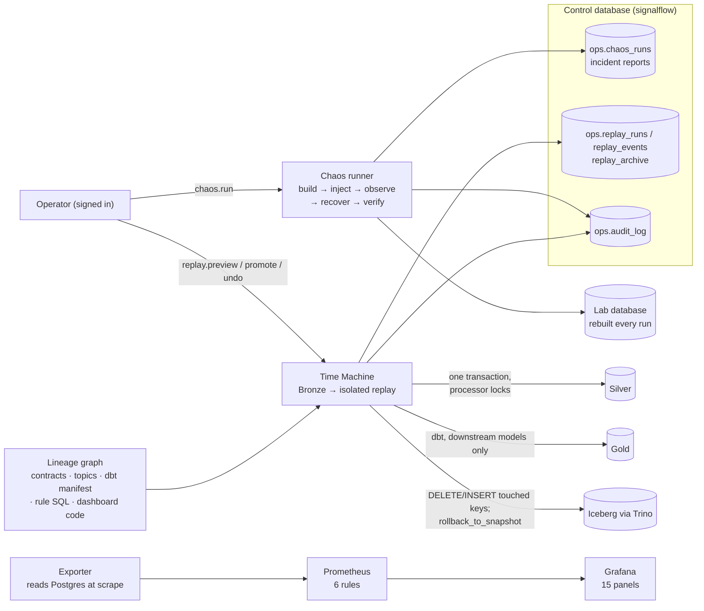

# Phase 5 Report: Chaos Lab, Data Time Machine, Lineage and Monitoring

Date: 2026-10-23. Environment: cloud Linux container, 4 vCPU, 15 GB RAM, Docker 27, Python 3.12, PostgreSQL 16,
dbt-core 1.11, Trino 478, Streamlit 1.50, Prometheus 3, Grafana 12.

## What now works



| Component | Path | Notes |
|-----------|------|-------|
| Decision records | `docs/adr/0011-…`, `0012-…`, `0013-…` | Chaos Lab in a disposable lab database; Time Machine replay from Bronze; lineage derived from code at table level, metrics read at scrape time |
| Chaos Lab | `chaos/lab.py`, `chaos/incidents.py`, `chaos/runner.py`, `chaos/worker.py` | Five incidents. Each run rebuilds the lab from a deterministic dataset, computes a clean-run reference, injects, observes, collects evidence, recovers and verifies. Incident D runs the Silver processor as its own OS process and kills it with SIGKILL. |
| Diagnostic alerts | `observability/alerts.py`, `ops.alerts` | CONTRACT_VIOLATIONS, DUPLICATE_SURGE, LATE_BEYOND_WATERMARK, PROCESSING_STALLED. Each is a SQL check. An alert opens, refreshes and resolves in one transaction, and names the records behind it. |
| Time Machine | `timemachine/replay.py`, `timemachine/lake.py`, `timemachine/defects.py` | Inspect a window; preview a replay into `ops.replay_events` (Silver untouched); promote in one transaction under the processor locks with a fingerprint re-check; undo from the archive; rebuild only the downstream Gold models and reconcile Gold with Silver; sync or roll back the Iceberg copies. Defects can only be simulated in a lab database. |
| Lineage | `lineage/catalog.py`, `lineage/graph.py`, `lineage/status.py` | 179 nodes and 614 edges, derived from the contract registry, the topic router, the dbt manifest, the rule SQL, the control tower code and the Superset charts. Every edge names its job. Impact, upstream and job-failure analysis per profile, with live freshness and the likely impact of each firing alert. |
| Monitoring | `observability/exporter.py`, `docker/prometheus/`, `docker/grafana/` | Standard-library exporter with 20 metric families. Prometheus rules: ExporterDown, DiagnosticAlertFiring, ProcessingBacklog, QuarantineIncrease, LeakHunterStale, LakeGoldMismatch. A provisioned Grafana dashboard. Everything binds to 127.0.0.1, and the Grafana password comes from the environment. |
| Permissions | `security.py`, migration `005_reliability.sql` | New permissions: `chaos.run`, `replay.promote` and `replay.undo` (operator), and `replay.preview` (analyst). Each is checked in the database layer and audited, including refusals. |
| CLI | `signalflow chaos …`, `signalflow replay …`, `signalflow lineage …`, `signalflow metrics …` | Passwords come from a prompt or an environment variable, never an argument. |
| Control tower | `ui/chaos_lab.py`, `ui/time_machine.py`, `ui/lineage_explorer.py` | Three new pages. They replace the "Planned" placeholders. |
| Makefile | `chaos`, `chaos-runs`, `replay-inspect`, `replay-preview`, `replay-list`, `lineage`, `metrics`, `observe-up`, `observe-down` | |

### The incidents

| Incident | Injected | What the platform must do | Recovery |
|---|---|---|---|
| A duplicate storm | 3 extra copies of recent recharges | log every copy in `ops.duplicate_events`; keep Silver, Gold and cases unchanged; raise DUPLICATE_SURGE | none needed: first arrival wins |
| B late surge | withheld recharges and billing, delivered after the watermark | accept and classify every event; list beyond-watermark events; mark final days RESTATED; auto-clear the TEL-01 cases they caused | dbt rebuild of the affected Gold models |
| C schema break | the same transactions in a renamed or retyped v1 shape | quarantine every record with a reason; keep the Bronze bytes; raise CONTRACT_VIOLATIONS; keep Silver and Gold clean | producer fix: records re-sent in the registered shape |
| D interruption | SIGKILL of the Silver processor mid-backlog | the stall is visible (checkpoint stops, backlog stays, PROCESSING_STALLED); no row past the checkpoint | restart; resume from the checkpoint |
| E stock discrepancy | an approval applied twice, and an adjustment that contradicts its approval | MFG-04 cases with the source records; the positions marked UNCERTAIN | approved recount plus an analyst resolution per case, both audited |

## Test results (real runs, 2026-10-23)

```
ruff check src tests                    -> All checks passed!
mypy src (strict)                       -> Success: no issues found in 68 source files
pytest tests/unit -q                    -> 138 passed in 2.65s
pytest tests/integration -q -rA         -> 32 passed in 410.20s   (15 Phase 1 + 6 Phase 4 + 7 Chaos Lab + 4 Time Machine)
pytest tests/lake/test_phase5_timemachine_lake.py -q -rA -> 1 passed in 96 s
```

| Phase 5 test | What it proves |
|------|----------------|
| `test_a_duplicate_storm_is_absorbed` | Every copy is in `ops.duplicate_events` against its first arrival. Silver and Gold revenue equal the clean run. No TEL-02 case opens. DUPLICATE_SURGE names the stream. |
| `test_b_late_surge_is_accepted_restated_and_reconciled` | Every withheld event is accepted with its lateness class. Beyond-watermark events are listed, and final days are marked RESTATED. The TEL-01 cases they caused are auto-cleared, never confirmed. After the rebuild, Gold equals the clean run. |
| `test_c_schema_break_is_quarantined_alerted_and_fixed` | Every broken record is quarantined with its reason. The contract report names the contract and the rule. The alert fires. Nothing invalid reaches Silver or Gold. After the fix, the books equal the clean run. |
| `test_d_killed_processor_resumes_to_the_clean_result` | A real SIGKILL leaves no row past the committed checkpoint. PROCESSING_STALLED fires. The restart resumes and the Silver fingerprint equals the clean run. |
| `test_e_stock_conflict_is_flagged_uncertain_and_resolved_with_audit` | Both conflicting movements are flagged by MFG-04. The positions are UNCERTAIN until the recount, then CONSISTENT. Stock equals the clean run, and each resolution is audited. |
| `test_viewer_cannot_run_an_incident_and_the_attempt_is_audited` | Role check in the runner, and a DENIED audit row. |
| `test_lab_refuses_protected_database_names` | The lab cannot be pointed at the demo, streaming, ERP, catalog, Airflow or Superset database. |
| `test_inflated_amounts_are_repaired_reconciled_and_undone` | In the lab, 20 inflated amounts are previewed as CHANGED. After promotion, Silver equals the clean run, Gold revenue equals the clean run, and reconciliation passes. Undo restores the damaged rows byte for byte. Every step is audited. |
| `test_deleted_events_are_reinserted_with_their_original_arrival_class` | Deleted manufacturing events come back as INSERT with the arrival class they had originally, reconstructed from `ops.processing_runs`. |
| `test_promotion_is_refused_when_silver_changed_after_the_preview_or_a_processor_runs` | A stale fingerprint is refused. A held processor lock is refused (ProcessorRunning). Discarding a preview works. |
| `test_guards_viewer_window_and_defects_outside_the_lab` | A viewer is refused. A window over 3 days or without a time zone is refused. A defect outside a lab database is refused. |
| `test_replay_is_synced_to_iceberg_and_undone_by_snapshot_rollback` | A promotion synced to Iceberg changes exactly the touched keys, verified row by row. Time travel to the pre-sync snapshot shows the damaged amounts. Undo uses `rollback_to_snapshot`, the current snapshot is the pre-sync one again, and a later publish accepts the lake. |
| `tests/unit/test_lineage.py` (8) | Derived event types, staging models and KPIs. Recharge reaches the Superset revenue chart through Kafka, Spark, dbt and the lake in stream, and through the Bronze loader in lite. Stopping Spark affects nothing in lite. KPI links need both model and column. Alert subjects map to nodes or to nothing. Column-level lineage is not claimed. |
| `tests/unit/test_observability_units.py` (3) | Prometheus text format and label escaping. Alert rules are unique and scoped by their window. Detection and processing code never imports the Chaos Lab or the Time Machine. |

## Demo results (the demo database `signalflow`, lab database `signalflow_lab`)

**Chaos Lab.** Operator `tanvir` (operator role) ran all five incidents. Results are from `ops.chaos_runs`:

| Run | Status | Checks | Seconds |
|-----|--------|-------:|--------:|
| CHAOS-A-20261023T161856-3b0b | PASSED | 7 / 7 | 21.2 |
| CHAOS-B-20261023T161918-5250 | PASSED | 8 / 8 | 27.5 |
| CHAOS-C-20261023T161946-8e1a | PASSED | 7 / 7 | 19.7 |
| CHAOS-D-20261023T162006-cdf7 | PASSED | 7 / 7 | 21.1 |
| CHAOS-E-20261023T162027-130b | PASSED | 9 / 9 | 19.6 |

**Time Machine, no defect.** A preview of one telecom day on the demo database replayed 4,011 Bronze records, and
all of them came out UNCHANGED. This is the evidence that lateness reconstruction and first-arrival-wins
reproduce Silver exactly.

**Time Machine, defect in the lab, driven from the UI:**

1. Damage Silver for 2026-10-02: 20 successful recharges ×10.
2. Preview: 3,782 records replayed. 3,737 unchanged, 20 CHANGED. Silver amount for that day ৳69,140.00 now
   vs ৳50,960.00 in the replay.
3. Promote: 20 rows applied in one transaction.
4. dbt rebuilt `stg_tel_recharge`, `fct_recharge` and `mart_telecom_revenue_daily`.
5. Gold gross recharge for the day went from ৳66,680.00 to ৳48,500.00, and the Silver reconciliation passed.

**Lineage.** 179 nodes, 614 edges and 13 jobs. In lite, the gross recharge revenue KPI depends on 8 sources and
event types and 6 dbt models. Stopping `spark_silver` in the stream profile affects 125 nodes, including all 14 KPIs
and all 15 dashboards. In lite it affects none.

**Monitoring.**

* A scrape takes about 0.1 s.
* Prometheus has both targets up.
* LeakHunterStale is **firing**, and that is correct: the demo's hunter last ran about 30 h ago. The alert shows
  that staleness is detected rather than hidden.
* The Grafana dashboard reads only exporter series. No panel has a hard-coded number.

Screenshots of the three new pages, Grafana and the Prometheus alerts were shared in the project thread. They
are not committed.

## Problems found while building, and fixes

* **Phase 2 stream test flake (CI).** The replay flushes the Kafka producer once per arrival file. Inside that
  span, partitions become visible at different times, so an event can be classified LATE_WITHIN by up to the span
  plus its transit time. It is never LATE_BEYOND. The first fix attempt changed the sink and was wrong, so it was
  reverted. The test now asserts the real bound: delivery skew plus transit plus 1 s, and only LATE_WITHIN is
  allowed.
* **Lineage fan-out.** Shared per-stream ops tables connected every telecom alert to manufacturing KPIs. They are
  now split per stream, and context edges carry a higher path weight.
* **Lineage read a manifest that another run had overwritten.** The lake and lab dbt runs write
  `target/manifest.json`. Lineage now parses into `target/lineage`.
* **Promote touched all 3,826 rows of a window.** Timestamps compared as text. Values are now normalised with
  `datetime.fromisoformat`.
* **Promote took 23 s.** Each row was fetched one by one. It is now fetched in bulk. Promotion is now well under a
  second for 20 rows.
* **Money compared as `48500.0` vs `48500.00`.** Amounts are now quantised to the poisha before comparing.
* **Payload defects were invisible to the comparison.** An inflated amount leaves `event_sha256` unchanged. The
  payload is now part of the compared columns and of the fingerprint.
* **Undo was not byte-exact.** A Python round trip turned jsonb `300.00` into `300.0`. Archiving and restoring now
  happen inside SQL (`to_jsonb` / `jsonb_populate_record`).
* **The current Iceberg snapshot was wrong after a rollback.** It was read from `$snapshots`. It is now read from
  `$refs` (`main`).
* **dbt in the lab selected models the lab never built.** The selection is now intersected with the built
  relations. A mart that is missing is reported as a skipped check, not a pass.
* **The UI could not find `dbt`** when Streamlit ran without the venv on PATH, so Gold was not rebuilt after a
  promotion. `run_dbt` now uses the dbt installed next to the interpreter. The page also offers **Rebuild Gold**
  for a promoted or undone replay whose rebuild failed.
* **UI issues found from screenshots:**
  * Lineage paths showed `telecom.recharge → telecom.recharge → telecom.recharge`, because the kind was dropped.
    They now show node ids.
  * The verification table was squeezed next to the timeline. It is now full width.
  * Dates in the freshness column crashed on a date without a time zone.
  * Grafana exposure values had no unit and truncated rule names.

## Limitations (honest list)

* **Lineage is table-level.** It also tracks the event type inside the shared Bronze and Silver tables. Column-level
  lineage is not captured. A KPI names its column, and nothing traces a column-to-column path.
* **Dashboard reads are found by static analysis** of string literals and module references. A table name built at
  run time would be missed. The current pages do not do that.
* **A replay cannot recover a record that Bronze never received.** The source must resend it (Incident C).
* **A replay applies the current code.** It repairs damage done by an older or faulty release. It does not reproduce
  old behaviour.
* **Chaos incidents run on the lite profile.** Spark restarts are covered by the Phase 2 stream tests, not by the
  Chaos Lab. Docker-level chaos (killing containers, partitioning the network) is not implemented.
* **Incident D proves resumption for its run**, by comparison with the clean run. Zero loss in general is not
  claimed.
* **The exporter counts rows on every scrape.** That is fine at demo scale (0.1 s). At larger volumes it would need
  maintained counters or estimates.
* **Prometheus and Grafana have no alert routing** (no Alertmanager receivers). Alerts are visible in Prometheus,
  Grafana and the control tower.
* **The lake undo's fallback path is not covered by a test.** When newer snapshots exist, undo re-syncs the keys
  from Postgres instead of rolling back. That path is implemented and verified row by row at run time, but no test
  forces it. The rollback path is tested.
* **The optional AI explanation module was not built.** Everything in this phase is deterministic.

## Demo instructions

```bash
make up && make run                              # demo database, if not built yet
make operator OPERATOR=tanvir ROLE=operator NAME="Tanvir Ahmed"     # password prompted
make chaos INCIDENT=B OP=tanvir                   # rebuilds signalflow_lab, runs the late surge, prints the report
make lineage NODE=event:telecom.recharge PROFILE=stream
make observe-up                                   # exporter, Prometheus 127.0.0.1:59090, Grafana 127.0.0.1:53000
make ui                                           # Trust → Chaos Lab, Time Machine; Platform → Lineage
```

In the UI, signed in as an operator:

1. **Chaos Lab:** pick an incident and run it. Open its report to see the checks against the clean run, the
   timeline, the alerts and the evidence.
2. **Time Machine:**
   1. Choose the lab database and a telecom day.
   2. Click **Damage Silver in this window**, then **Preview a replay**. The CHANGED rows show the inflated and the
      replayed amounts.
   3. Click **Promote and rebuild Gold**. The Gold diff and the reconciliation appear.
   4. Click **Undo and rebuild Gold** to restore the damage exactly.
3. **Lineage:**
   1. **Impact of a change:** pick an event type.
   2. **A job stops:** switch to the stream profile and pick Spark to see what goes stale.
   3. **Root cause of a figure:** pick a KPI to see its sources.
